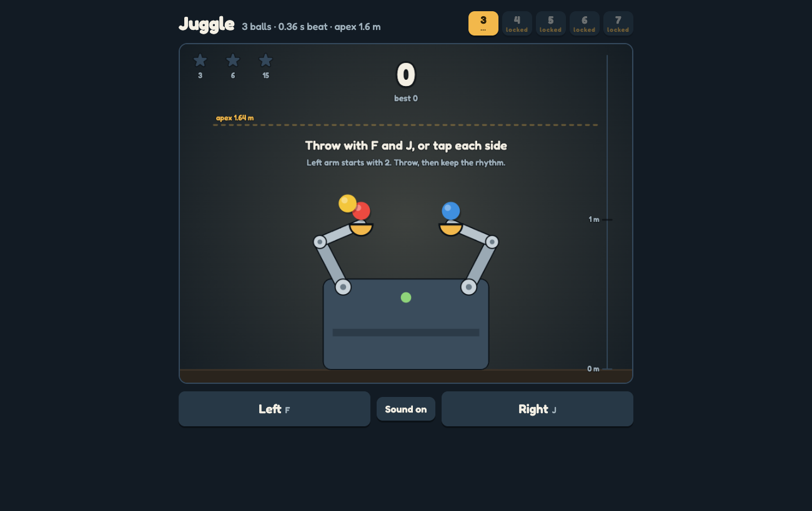

# Juggle

### ▶ [Play Juggle in your browser](https://louisvandenbruwaene.github.io/juggle/)

No install, no account: open the link and play. Throw with F and J (or tap each side of the screen) and keep the rhythm.

[](https://louisvandenbruwaene.github.io/juggle/)

Juggle: 3 to 7 balls, real gravity, same height, faster beat each level. One self-contained HTML file, no build step: open [`index.html`](index.html).

## Play on this Mac

```
./app/install_app.sh   # puts Juggle in /Applications
./app/make_icon.sh     # only needed after editing app/icon.html
```

The app opens the game in its own Brave window. The folder path is baked in, so re-run `install_app.sh` if this folder moves.
